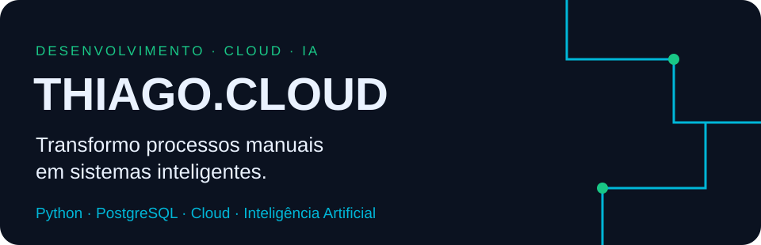
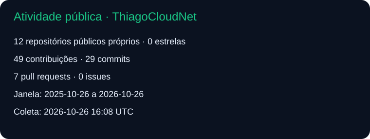
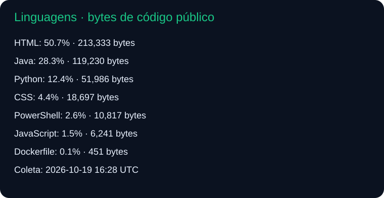

# Olá, eu sou Thiago!

Sou **Thiago Ferreira Prates Neves**, estudante de Tecnologia em Análise e Desenvolvimento de Sistemas na **Universidade Estadual do Sudoeste da Bahia (UESB)**. Desenvolvo projetos acadêmicos e organizo iniciativas de software por meio da **Thiago.Cloud**.

Meu foco é transformar processos manuais em sistemas inteligentes, com atenção à organização dos dados, usabilidade, acessibilidade e documentação. Tenho interesse em sistemas de gestão, automação, APIs, cloud e inteligência artificial aplicada a problemas reais.

[Portfólio Thiago.Cloud](https://thiago.cloud) · [Repositórios públicos](https://github.com/thiagocloudnet?tab=repositories)

## Formação e aprendizado

Minha graduação está em andamento. Os projetos públicos registram meu aprendizado em programação web, orientação a objetos, estruturas de dados e engenharia de software. Banco de dados, desenvolvimento mobile, estatística computacional e modelagem de sistemas também fazem parte das áreas de estudo que desejo aprofundar.

## Tecnologias

**Código público identificado:** Python, Java, JavaScript, HTML e CSS. Há estrutura Django no Agente Educação, automação com GitHub Actions e arquivos Docker no RAD UESB. A presença de arquivos não comprova uma implantação em produção.

**Foco declarado e evolução:** PostgreSQL, SQL, pgvector, APIs REST, RAG, Linux, Nginx, Cloudflare e automação de atendimento. Essas áreas não são apresentadas como certificações ou integrações concluídas.

## Educação, Acessibilidade e Inteligência Artificial

### NEXO — Assistente Digital Estudantil

**Projeto-piloto · Fale. Entenda. Acompanhe.**

Proposta de assistência acadêmica com IA para apoiar organização de estudos, orientação e acesso ao conhecimento. RAG, interpretação de documentos e integrações acadêmicas são recursos propostos, sem implementação pública confirmada nesta auditoria.

### UESB-TEM — Tecnologia, Educação e Multimídia

**Em desenvolvimento, conforme apresentação do projeto · Seu tempo. Mais futuro.**

Plataforma concebida para organizar biblioteca, documentos, agenda, grupos de estudo e assistência digital. Código e stack próprios ainda não foram localizados nos repositórios públicos auditados. Integrações com Moodle e SAGRES não estão comprovadas.

### UEAD — União dos Estudantes a Distância

**Iniciativa independente em organização.**

Educação a distância. Conexões reais. Estudantes mais fortes. Uma iniciativa de participação estudantil e compartilhamento autorizado de conhecimento. Biblioteca solidária e base RAG permanecem em preparação.

[Conhecer a UEAD](https://uead.com.br) · [Central do Estudante](https://meajuda.uead.com.br)

Os endereços estavam acessíveis na auditoria; a disponibilidade dos serviços não foi testada. As três iniciativas mantêm identidades e responsabilidades próprias, sem vínculo oficial comprovado com universidades. A UEAD não é apresentada como associação registrada ou representação oficial.

[Detalhes, próximos passos e limites de verificação](docs/projetos-educacionais.md)

## Outros projetos de software

| Projeto | Conteúdo e estágio verificados |
| --- | --- |
| [Hotel Pet](https://github.com/thiagocloudnet/hotelpet) | Protótipo acadêmico estático de hospedagem de pets, em HTML/CSS. [Demonstração](https://hotelpet.shop/projeto/). |
| [RAD UESB](https://github.com/thiagocloudnet/rad-uesb) | Central acadêmica pessoal em desenvolvimento; HTML, Python e estrutura Docker. Não substitui sistemas oficiais. |
| [Árvore Genealógica](https://github.com/thiagocloudnet/arvore-genealogica) | Projeto acadêmico Java com estrutura de árvore, interface e persistência em arquivos. Execução não testada nesta auditoria. |
| [Café Expresso](https://github.com/thiagocloudnet/cafe-expresso) | Simulação acadêmica de autoatendimento em Java. O PIX descrito é simulado. |
| [Árvore DOM](https://github.com/thiagocloudnet/pw2-arvoredom) | Exercícios HTML/CSS/JavaScript com eventos e manipulação do DOM. [Demonstração](https://thiagocloudnet.github.io/pw2-arvoredom/). |
| [Agente Educação](https://github.com/thiagocloudnet/agenteeducacao) | Estrutura inicial Python/Django; models e views ainda sem regras de negócio. |

[Catálogo completo e evidências](docs/projetos.md)

### Ecossistema Thiago.Cloud

Também organizo propostas de sistemas de gestão, atendimento, identidade, dados, hospedagem, saúde, apoio acadêmico, pagamentos, jurídico e acessibilidade. UPainel, UPZap, UPKey, UPDados, UPHost, SysFono, UPTCC, UzaPix, AdvOmnis e Acessai.Cloud são nomes declarados no planejamento: não representam produtos disponíveis ou funcionalidades comprovadas por esta auditoria.

[AIDoutor](https://github.com/thiagocloudnet/aidoutor) apresenta a proposta de agente de engenharia de software; o desenvolvimento fica em repositório privado separado.

[UPSaúde](https://github.com/thiagocloudnet/upsaude) é a plataforma de saúde em desenvolvimento, anteriormente referida como UPAR. A regulação UPAR passa a ser um módulo interno; a consolidação dos legados ainda depende de validação.

## GitHub em números

Dados coletados pela API do GitHub e armazenados neste repositório. Linguagens representam bytes de código em repositórios públicos próprios, excluindo forks; **não medem proficiência profissional**. Contribuições cobrem a janela anual informada pela API. Se uma atualização falhar, os últimos gráficos válidos permanecem disponíveis.

## Onde me encontrar

- [Thiago.Cloud — portfólio](https://thiago.cloud)
- [ThiagoCloudNet — GitHub](https://github.com/thiagocloudnet)

**Thiago.Cloud — Transformando ideias e processos em soluções digitais.**
